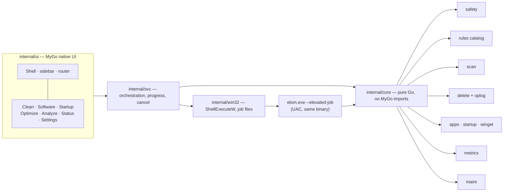

# Elom — Windows cleaner & system utility

## Overview

Elom is a native Windows utility written with [MyGo](https://mygo.egoist.dev) native UI (Go, no cgo, no WebView2). It reproduces the functionality of [Mole for Windows](https://mole.fit/windows): review-first cleanup, uninstall with leftover review, winget updates, startup control, safe maintenance, disk treemap and a live status dashboard, plus a tray panel, Keep Screen On and Clean Screen.

The product differentiator is the safety model, not the feature list: every destructive action is a review over an explicit, sized, reasoned list; deletions go to the Recycle Bin by default; a guard refuses system paths; a whitelist protects what the user keeps; every deletion is logged and the log is fail-closed (no log, no delete).

The project starts from an empty directory (`D:/Dev/elom`). Windows 10 22H2+ and Windows 11 are the targets, amd64 first; pure Go means an arm64 build costs only a flag.

## Product contract

| Field | Value |
|---|---|
| Outcome | Six working modules (Clean, Software, Startup, Optimize, Analyze, Status) plus tray panel, Keep Screen On, Clean Screen, shipped as a per-user NSIS installer |
| Constraints | MyGo 0.8.x native UI; Go 1.27 (installed); `CGO_ENABLED=0`; no GPL code copied from Mole (its CLI is GPL-3.0) — behavior is reimplemented, our code is MIT |
| Constraints | UI never runs elevated; privileged work runs in a separate elevated invocation with its own validation and one UAC prompt per session |
| Non-goals | macOS/Linux builds, payments/licensing, antivirus, registry cleaning, MFT/USN fast scan, cloud sync, Windows 10 below 22H2 |
| Acceptance | The nine acceptance criteria in [Success Criteria](#success-criteria) |

## Architecture

**Import boundary.** `internal/core/...` must never import `github.com/egoist/mygo`; `internal/core/arch_test.go` enforces it by shelling out to `go list -deps`. This is the one seam the plan creates, and it has a credible second case: a `mo`-style CLI. A CLI would reuse every `core` package unchanged and replace only the progress transport in `internal/svc` (in-process callbacks → stdout/JSON). One real case stays concrete; no CLI, plugin system or abstraction layer is built now.

**Verified framework facts** (from upstream docs and source at v0.8.3):

| Need | API |
|---|---|
| Tray | `mygo.NewTray(mygo.TrayOptions{Icon, IconIsTemplate, ToolTip, Menu, ID})`, `Tray.OnClick`, `Tray.Bounds`, `Tray.PopUpMenu`, `Tray.SetToolTip` |
| Floating panel | `mygo.WindowOptions{Panel, Hidden, Frameless, Transparent, Vibrancy, CornerRadius, DisableResize, Content}` |
| Global shortcut | `mygo.GlobalShortcut.Register(acc string, fn func()) error` (Windows: `RegisterHotKey`) |
| Recycle Bin | `mygo.Shell.TrashItem(path)` — fails rather than deleting for good |
| File icons | `mygo.Shell.FileIcon(path, size)` (Windows `IShellItemImageFactory`) |
| Keep screen on | `mygo.Power.KeepAwake(reason string, display bool) (release func())` |
| Tree widget | `ui.Outline(c, *ui.OutlineState[T], roots []T, children func(T) []T, row func(T))` |
| Virtualized table | `ui.Table(c, *ui.ListState, columns []ui.TableColumn, n int, cell func(row, col int))` |
| Custom paint + hit test | `Element.Draw(func(p *ui.Painter, r ui.Rect))`, `Element.HitTest(func(x, y float32, r ui.Rect) bool)` |
| Sparklines | `chart.Plot`, `chart.Line`, `chart.MinMax` |
| Metrics | `github.com/shirou/gopsutil/v4` — Windows amd64/arm64, "all works are implemented without cgo" |
| i18n | `mygo.json` → `{"i18n":{"dir":"locales","source":"en"}}`, generated `locales` package |
| Test without a window | `ui.NewTester(view, width, height)` |

## Phases

| # | Phase | Status |
|---|-------|--------|
| 1 | [Spike & Skeleton](./phase-01-spike-skeleton.md) | Pending |
| 2 | [Clean Engine](./phase-02-clean-engine.md) | Pending |
| 3 | [Disk Analyze](./phase-03-disk-analyze.md) | Pending |
| 4 | [Live Status](./phase-04-live-status.md) | Pending |
| 5 | [Apps & Startup](./phase-05-apps-startup.md) | Pending |
| 6 | [Optimize & Elevation](./phase-06-optimize-elevation.md) | Pending |
| 7 | [Package & Release](./phase-07-package-release.md) | Pending |

## Success Criteria

1. `go tool mygo build -platform windows/amd64` produces `build/windows-amd64/elom.exe` and a per-user NSIS installer that installs and uninstalls cleanly without administrator rights.
2. Clean scans user caches in ≤ 20 s on a real profile, shows path/size/reason per item, and deletion lands in the Recycle Bin and can be restored.
3. The guard refuses `C:\Windows`, `C:\ProgramFiles*`, profile roots, reparse points and UNC paths (unit-tested table), and Clean refuses to run when the whitelist or oplog cannot be read.
4. Analyze opens `C:\Users\<user>` within ≤ 15 s, drills down five levels, lists largest files, and trashes a selection to the Recycle Bin.
5. Status updates CPU/RAM/disk/network at 1 Hz with 60-sample sparklines, lists the top processes, uses under 1% CPU at idle, and the tray panel opens from a global shortcut.
6. Software lists installed apps within 5% of Settings › Apps, runs a real uninstaller, and shows leftovers unchecked by default.
7. Startup lists Run keys, StartupApproved state and the startup folders; toggling one entry survives a reboot and can be reverted exactly.
8. Optimize runs dry-run first and reports a skip reason without administrator rights; with elevation each task is a whitelisted op validated again in the elevated process.
9. No crash on unreadable directories or locked files; every skipped item states why.

## Key Risks

| Risk | Mitigation |
|---|---|
| MyGo 0.8.x is young; widget behavior on Windows 10 unverified | Phase 1 spike gates every screen; pin `github.com/egoist/mygo` version; no API outside docs |
| Walking large volumes is slow; sizing can over-count hard links | Measure in phase 3; document over-count; MFT scan is an explicit non-goal |
| `winget` table output is locale-dependent | Tolerant parser + fixture tests; UI states parsing may be imperfect; never apply an update the user did not select |
| StartupApproved binary semantics | Verify by toggling with Task Manager, comparing bytes, then reboot test in phase 5 |
| UAC helper regresses safety | Elevated process re-validates a closed op table; unknown ops refused; oplog written by the elevated side too |

## Open Questions

1. Repository/module path: `go mod init elom` for now; rename mechanically once a git remote exists.
2. Code signing certificate not available: ship unsigned with SHA-256 checksums and document the SmartScreen warning; `windows.certificate` hook stays ready.
3. Windows 10 22H2 test machine availability — if absent, Windows 10 support stays marked unverified in `docs/verification.md`.

## Dependencies

- MyGo v0.8.3 CLI: `go tool mygo` (pinned as a Go tool dependency).
- `github.com/shirou/gopsutil/v4`, `golang.org/x/sys/windows`.
- NSIS: `mygo build` downloads it on first use on Windows.

## Post-review repairs (2026-11-10)

The code review found one blocking defect and several swallowed failures; all are fixed and
tested. Evidence: 15 test packages green, `-race` clean, `go vet` silent, launch smoke alive.

| Finding | Repair | Evidence |
|---|---|---|
| View walked leftover trees every frame | sizes measured once in `svc.Software.Leftovers`, carried in `apps.Leftover.Bytes` | view test renders `2.0 kB` from state with a nonexistent path |
| winget apply hid errors and output | failures set `updatesErr`, last lines streamed | code path + headless view test for the error state |
| Enumeration failures looked like "no apps" | `apps.Enumerate` errors when no hive opened; `Software.List` returns warnings | `svc` tests for both |
| Scan goroutine read `a.Settings` | limits captured before `go` | structural; race run clean |
| Operation log opened + synced per record | `oplog.Log.Run` reuses one handle | 0.92 → 0.42 ms/record, 200 records, fsync kept |
| Parity test missed ICU typed placeholders | compares argument names, new test | `{count, number, integer}` vs `{total, …}` differ |
| Quit before ready panicked | nil guard in `OnBeforeQuit` | build + smoke |
